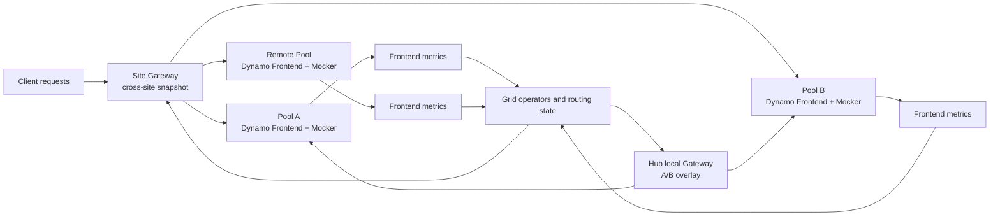

# Praxis Grid × Dynamo signal routing

This demo shows Grid using Dynamo Frontend signals to prefer a less-pressured
inference pool. It connects real model-readiness and active-request metrics to
Grid's candidate scores, routing snapshots, Gateway consumption, and observed
requests across three pools at two sites.

## Recorded demo

<!-- markdownlint-disable-next-line MD034 -->
https://github.com/user-attachments/assets/2f1edf83-014a-457c-936b-e1a2cd62c6ae

## User stories

- **Platform engineer:** See how a serving signal changes Grid's candidate
  ranking and the route used by a subsequent request.
- **Inference operator:** Distinguish model readiness from current active
  work, and trace each observation through the routing revision consumed by a
  Gateway.
- **Demo presenter:** Apply bounded pressure to a chosen pool, observe the
  routing shift, release the work, and verify recovery.
- **Reviewer:** Keep the evidence and its limits together: real Frontend
  telemetry, synthetic Mocker responses, and no claim of weighted-share
  precision.

## What it demonstrates

| Capability | Demonstrated behavior |
| --- | --- |
| Dynamo readiness | Each Frontend reports whether its model is ready to serve. |
| Active-request pressure | Grid observes Frontend-wide active requests and compares them with a configured reference. |
| Candidate routing | Fresh eligible-pool signals change Grid's ranking and routing state. |
| Local and cross-site views | The Hub Gateway uses an A/B local overlay; a separate Site Gateway snapshot includes the Remote Pool. |
| Recovery | After pressure ends, fresh observations and routing revisions converge before a new sample is sent. |
| Attribution | The Site route reports the pool selected for each request; the Hub route is attributed using its isolated Gateway counter delta. |

This recording shows traffic shifting toward an unpressured pool and returning
across the pools after recovery. It does not measure an exact traffic share.

## Topology

Pool A and Pool B run as separate Frontend + Mocker workloads at the Hub
site. The Remote Pool runs at the separate Site. Dynamo Frontend routes to its
own Mocker worker; Grid chooses a pool or site from the signals and policy it
receives. The Hub local overlay contains A and B. The Site Gateway consumes a
separate cross-site snapshot containing all three pools.

## Signals and routing

The recording exercises two Dynamo Frontend measurements:

- `dynamo_frontend_model_ready`: model-scoped readiness.
- `dynamo_frontend_active_requests`: Frontend-wide active work.

Pressure begins only after the presenter sends bounded direct requests to a
pool's Mocker. Those requests raise the corresponding Frontend's active
request gauge while they are in flight. Grid uses fresh, comparable
observations to update candidate scores and routing state; a later request
shows the resulting route.

The configured comparison reference of four is a demo policy value. It is not
a Dynamo queue limit, Mocker replica count, or measured serving capacity. This
recording does not read llm-d EPP queue depth or KV-cache utilization. The
slides describe llm-d/EPP as a separate serving-framework integration; no
llm-d workload is deployed in this recording.

The recording uses declared peers and secure signal polling. It does not show
live SWIM. Mocker returns synthetic inference responses; the Dynamo Frontend
metrics are real runtime telemetry.

## Demonstration sequence

1. Confirm the three pools are ready and inspect the baseline request sample.
2. Apply bounded direct request pressure to Pool B and the Remote Pool.
3. Wait for fresh Frontend metrics and Grid routing state, then send a new
   Site Gateway sample. The sample shifts toward unpressured Pool A.
4. Release the direct work, wait for fresh recovery observations, and send a
   new sample to verify that traffic reaches the pools again.

Samples are independent observations, not exact percentages. The presenter
should wait for fresh signal and consumed-revision evidence before describing
a route change or recovery.

## Historical qualification

The supplied UI capture is historical, not a live deployment. Its saved
qualification used Grid commit
`0fc905dfae058e5c54ddebdc384e345fbfecc1a4`, Grid source-state SHA-256
`c7bc7a45c371ea7503dda53ef39cee65700d359921f3f9dbafaed9840ff91df2`, and
Dynamo planner image
`nvcr.io/nvidia/ai-dynamo/dynamo-planner@sha256:f69ac8f2165289e0f9d06aa125fac8bda3a401b42f640235fca28b0c852b9875`
(`linux/amd64`). The saved run covered pressure, routing, and recovery. The
packaged dashboard backend changed after that Playwright run, so this
recording is not a live qualification of the current source tree.

## Run the dashboard

A live run requires separately provisioned, run-owned Hub and Site Kind
clusters, current Grid and Dynamo workloads, private runtime configuration,
and fresh readiness checks. The dashboard source is maintained separately
from this experimental demo documentation. This checkout does not provide a
complete standalone cluster-provisioning recipe; do not treat the recording,
a leftover listener, or saved screenshots as current live evidence.

## Evidence and limitations

- The active-request value is a plain count. Four is the configured comparison
  reference, not a queue limit or measured capacity.
- Mocker responses are synthetic. The demo does not prove GPU saturation or
  model quality.
- The traffic samples show observed routing and recovery, not equal-share or
  weighted-share precision.
- Dynamo Frontend stage counters are not llm-d EPP queue metrics.
- The optional failure control interrupts a signal endpoint. It is not a
  network ACL test or a live SWIM partition.
